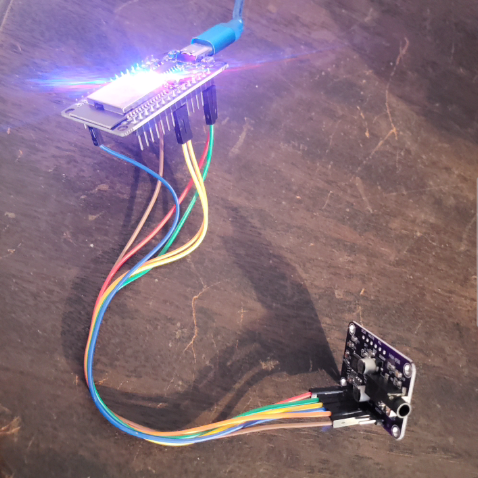
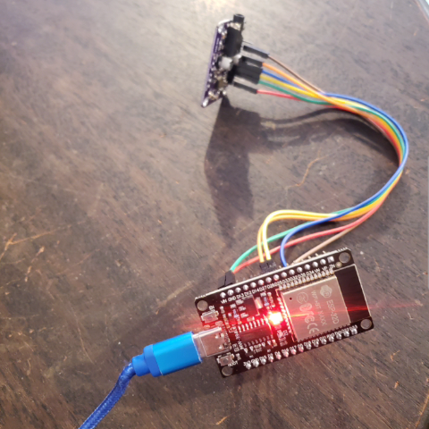
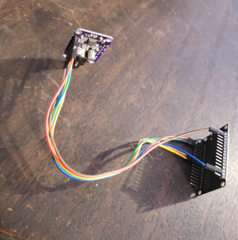

# ESP32 Bluetooth Stereo Adapter

**DIY Bluetooth A2DP Receiver | ESP32 + UDA1334A I²S DAC**

A homemade Bluetooth audio receiver designed to bring modern wireless audio to a vintage 1990s home stereo.

Built using an ESP32 microcontroller, a UDA1334A digital-to-analog converter, and Arduino IDE.

**Status: Fully functional — tested November 24, 2026.**

---

## Finished Build







---

## Features

- Bluetooth A2DP stereo audio reception
- UDA1334A I²S digital-to-analog conversion
- Onboard LED indicating Bluetooth connection status
- Analog stereo output for AUX/LINE inputs
- Compatible with Bluetooth-enabled computers and mobile devices
- No Wi-Fi or internet connection required

## Hardware

- ESP32 development board (Bluetooth Classic capable)
- UDA1334A I²S DAC
- Jumper wires and soldered connections
- 3.5mm stereo audio cable / RCA adapter
- USB power supply
- Vintage stereo receiver

## Final Wiring

| Wire | ESP32 | UDA1334A |
|---|---|---|
| Red | VIN | VIN |
| Teal | GND | GND |
| Orange | GPIO 26 | BCLK |
| Yellow | GPIO 25 | WSEL / WS |
| Blue | GPIO 22 | DIN |
| Brown | GND | AGND |

## How It Works

```text
Bluetooth Audio Source
         |
     Bluetooth A2DP
         |
         v
        ESP32
         |
      I²S Audio
         |
         v
     UDA1334A DAC
         |
    Analog Stereo
         |
         v
   Vintage Stereo
         |
         v
       Speakers
```

The ESP32 receives Bluetooth audio and sends digital audio data to the UDA1334A through I²S. The DAC converts it to analog stereo audio for playback through a traditional amplifier.

## Firmware

Developed using Arduino IDE and the `BluetoothA2DPSink` library.

The firmware handles Bluetooth reception and controls the ESP32's onboard connection-status LED.

**Bluetooth device name:** `ESP32_BT_Stereo`

| Connection | LED |
|---|---|
| Disconnected | OFF |
| Connected | ON |

## Setup

1. Install Arduino IDE, ESP32 board support, and the BluetoothA2DPSink library.
2. Open and upload `DIY_BT.ino` to the ESP32.
3. Connect the UDA1334A according to the wiring table.
4. Connect the DAC's analog output to a stereo AUX/LINE input.
5. Pair a Bluetooth source with `ESP32_BT_Stereo`.
6. Select it as the audio output and play music.

**Do not connect to a PHONO input.**

## Design & Development

The project began in July 2026 using an ESP32 and PCM5102A DAC. The original assembly was unsuccessful and never produced music.

Development continued through hardware troubleshooting, soldering, and replacement of the original DAC with a UDA1334A module.

On November 24, 2026, the revised adapter successfully streamed music from a Windows 11 computer to a vintage stereo.

Initial testing from a phone produced intermittent audio glitches. Testing with the computer produced clear, smooth playback, helping isolate the problem to the phone-side connection or interaction rather than a universal receiver failure. Most likely due to the condition of the phone used.

A ground loop isolator was also tested but proved unnecessary for the working configuration. Audio seemed clearer without it.

**Final result:** A functional, independently assembled Bluetooth stereo receiver.

## AI Assistance Disclosure

AI assisted with technical guidance, troubleshooting, firmware development, and documentation.

The author performed the physical assembly, soldering, wiring, firmware uploads, hardware testing, and verification of the working device.

AI-assisted development is disclosed for transparency.

## License

MIT License

## Author

**Trevor Youmans**

Built as a personal embedded electronics project combining hardware, software, and a little 1990s stereo nostalgia.

"It's just a signal that needs pulled from the air and converted..."
